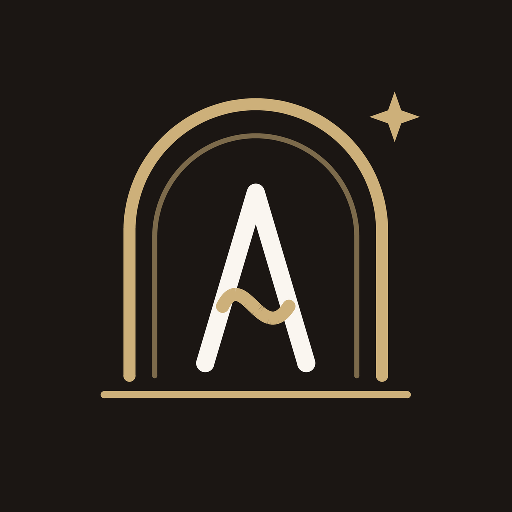

# Aurelle: Salon Mobile App

<p align="center"></p>

A premium salon app for iOS and Android with online appointment booking. Built with **React Native 0.87** (the plain React Native CLI, no Expo) and TypeScript.

"Aurelle" is a sample brand. Branding, contact details, hours, services, team and offers are all driven by a few configuration files, so the app can be re-branded for any salon.

This is the mobile companion to the [Aurelle salon website](https://github.com/HammadKang/salon) and shares its design language and booking logic.

## Features

- **Brand and intro:** a custom logo (a mirror-shaped arch holding a monogram "A" whose crossbar is a strand of hair) that **draws itself** in a full-screen animated intro, with a glow, pulsing rings, drifting gold dust, a letter-by-letter wordmark and a soft zoom-out. Tap to skip. It respects the system "Reduce Motion" setting.
- **Motion throughout:** scroll-triggered section reveals, counting statistics, a parallax hero with twinkling sparkles, press-scale feedback on cards and buttons, springy tab icons, and a check mark that draws itself with a sparkle burst on booking confirmation.
- **Home:** cinematic hero with parallax, signature treatments carousel, first-visit offer, team preview, testimonials, and opening hours with one-tap call, WhatsApp and directions.
- **Services:** all treatments with category filters, duration, "from" prices and promo labels. Tapping a service starts booking with it preselected.
- **Booking in five steps:** service, stylist (or any available), date and time, details, review. Availability is calculated live from the salon's opening hours, service duration and stylist days off.
- **Delivery by WhatsApp:** after confirming, the customer sends the pre-written booking to the salon on WhatsApp. No backend is required.
- **My bookings:** upcoming bookings are remembered on the device and shown in the Visit tab.
- **Gallery:** masonry portfolio with category filters and a full-screen swipeable viewer.
- **Team:** stylist profiles with "Book with ..." shortcuts.
- **Welcome offer:** shown once after a short delay, with a cool-down, and applied automatically at booking.
- **Accessible:** roles, labels and states on interactive elements, 44 pt minimum touch targets, form errors announced.

## Tech stack

| Area | Technology |
|---|---|
| Framework | React Native 0.87, React 19, TypeScript |
| Navigation | React Navigation 7 (bottom tabs and native stack) |
| Storage | AsyncStorage |
| Icons | lucide-react-native (react-native-svg) |
| Animation | React Native `Animated` (native driver where possible), react-native-svg stroke drawing |
| Tests | Jest |

## Requirements

- **Node.js 22.11 or newer** (required by React Native 0.87)
- **iOS:** macOS, Xcode, CocoaPods
- **Android:** Android Studio, JDK 17, an emulator or device

Follow the official [React Native environment setup](https://reactnative.dev/docs/set-up-your-environment) if this is a new machine.

## Getting started

```bash
npm install

# iOS (first time only)
cd ios && pod install && cd ..

npm start            # Metro bundler
npm run ios          # in a second terminal
npm run android
```

Other scripts:

```bash
npm test             # unit tests (booking engine, validation, formatting)
npm run lint
npx tsc --noEmit     # type-check
```

## Project structure

```
App.tsx                      Providers and navigation root
src/
  config/salon.ts            Brand, contact, hours, offer and booking rules
  data/                      Services, stylists, gallery, testimonials, FAQs
  lib/                       Booking engine, storage, formatting, contact helpers
  context/AppContext.tsx     Saved bookings and offer state
  navigation/                Tabs, stack and the useBook() helper
  screens/                   Home, Services, Gallery, Team, Visit, Booking
  brand/                     Logo geometry, logo components, animated splash
  components/                Button, Calendar, Reveal, Motion helpers, shared UI
__tests__/                   Booking engine tests
```

## Customising the app

| To change | Edit |
|---|---|
| Name, phone, WhatsApp number, email, address, hours, offer, booking rules | `src/config/salon.ts` |
| Closed days and already-taken times | `closedDates` and `blockedSlots` in `src/config/salon.ts` |
| Services, durations and prices | `src/data/services.ts` |
| Team | `src/data/stylists.ts` |
| Gallery, testimonials, FAQs | `src/data/content.ts` |
| Photos | `src/lib/images.ts` (Unsplash ids) or local images |
| Colours and typography | `src/theme.ts` |
| Logo | `src/brand/geometry.ts` (shapes), `src/brand/Logo.tsx`, `assets/logo.svg` |
| Intro animation | `src/brand/Splash.tsx` |
| App icon | `ios/.../AppIcon.appiconset` and `android/.../mipmap-*` (artwork in `assets/`) |

Opening hours, service durations and stylist days off feed the booking engine directly, so changing them changes which times customers can choose.

## How booking works (no backend)

Everything runs on the phone.

1. **Live availability** is computed from opening hours, service duration, stylist working days, minimum notice and the booking window. The salon time zone is a fixed UTC offset in the config.
2. **Confirmation screen:** after confirming, the customer sees a reference such as `AUR-7KD4M2` with the full summary.
3. **Delivery:** the **Send to salon on WhatsApp** button opens WhatsApp with the whole booking pre-written. The salon receives it on its own WhatsApp number and confirms the slot.
4. **Saved on the device:** bookings are stored with AsyncStorage, so they survive restarts, and the same slot cannot be booked twice from that phone.

### Limitations

- Availability is **not shared between customers**. Two people can pick the same time; the salon resolves it when the WhatsApp message arrives. The app therefore says "booking received" and asks the customer to send it, instead of claiming the salon has confirmed.
- Keep the calendar aligned with the real diary by updating `closedDates` and `blockedSlots` and releasing an update.
- A shared live diary and automatic notifications for the salon require a backend. The booking logic in `src/lib/engine.ts` is independent of the UI so one can be added later.

## Before releasing

The following are placeholders and must be replaced with real information:

- Address (a Karachi example), email domain, prices, team names and portraits, and the three testimonials. Publish only genuine client reviews.
- The 10% first-visit offer is a sample. The booking records the code and the salon decides eligibility at the visit. Set `offer.enabled` to `false` if there is none.
- Photography comes from Unsplash for demonstration. Confirm licensing or replace with the salon's own photos.
- Change the bundle identifier (`org.reactjs.native.example.Salon-mobile-app`) and the Android `applicationId` before publishing to the stores, and set up signing.
- Headings use the system serif (Baskerville on iOS). Bundle a font such as Cormorant Garamond for a pixel-exact match with the website.

## Quality checks

- Type-check, lint and 10 unit tests pass.
- JavaScript bundles successfully for both iOS and Android.
- Built and run on the iOS Simulator (iPhone 17 Pro). The intro animation was checked frame by frame, including that there is no white flash before it. Verified by hand: home, services, the full booking flow including validation and confirmation, bookings persisting after an app restart, the gallery viewer, and the welcome offer.
- **Not yet verified:** a full Android build and run, small phones and tablets, and VoiceOver/TalkBack behaviour.
